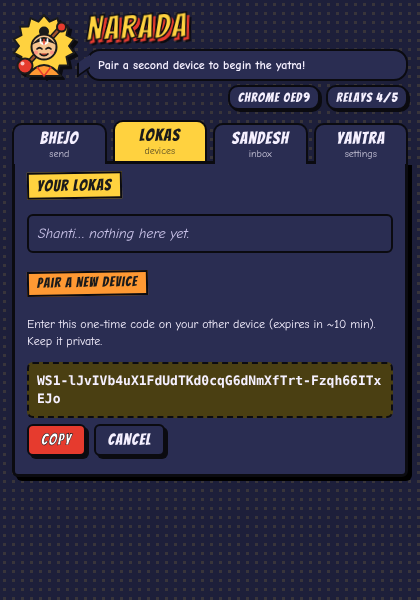
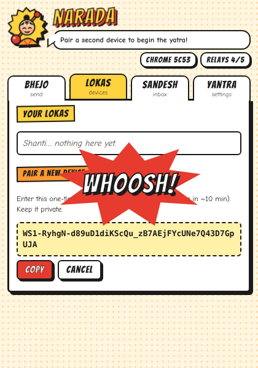

<p align="center"></p>

# Narada: *Narayan Narayan!* Your tabs, across every loka.

In the Bhagavata Purana, **Narada Muni** is the divine sage who wanders between
all the lokas carrying news, veena in hand. **Narada** the extension carries your
tabs (and, if you choose, your logins) between your browsers. It does this
**peer-to-peer**, with no central server in between.

<p align="center">
  
  
  
</p>

* **Works in every Chromium and Firefox browser**, in any combination (Chrome ↔ Firefox,
  Edge ↔ Brave, LibreWolf ↔ Opera…).
* **No central server in the data path.** Free public Nostr relays only carry the
  encrypted handshake. Then the browsers talk directly over WebRTC, and the relay
  sockets close.
* **Google STUN only, no TURN**, so no server ever relays your traffic.
* **End-to-end encrypted and mutually authenticated** with pinned device keys,
  ephemeral ECDH, AES-256-GCM and replay protection, on top of DTLS.
* **Send only the tabs you pick**, optionally with their **cookies and site storage**,
  so you stay logged in. The receiving device must approve every transfer.
* A **comic-book UI** with speech bubbles and sound-effect bursts, in light and dark mode.

## Supported browsers

| Family | Build | Notes |
|---|---|---|
| Chrome, Edge, Brave, Opera, Vivaldi, Arc, other Chromium ≥ 110 | `dist/chromium` | Uses an offscreen document. Forks without that API automatically get a minimized helper window instead. |
| Firefox, ESR, LibreWolf, Waterfox, Floorp, Zen, other Gecko ≥ 115 | `dist/firefox` | Persistent background page (MV2), so connections aren't suspended. |
| Safari | ✗ | Safari extensions can't run WebRTC in the background. |

Tested end to end: Chromium ↔ Chromium, Chromium ↔ Firefox ESR, and the
no-offscreen fallback. Each run covered pairing, connection, a cookie and storage
transfer, and remote tab listing.

> **Brave / LibreWolf / hardened setups:** WebRTC must be allowed. In Brave, set
> *Settings → Privacy → WebRTC IP handling policy* to anything except
> "Disable non-proxied UDP". In LibreWolf, set `media.peerconnection.enabled = true`.
> Narada shows a warning when WebRTC is unavailable.

## Install (from source)

```bash
npm install
npm run build        # -> dist/chromium (MV3) and dist/firefox (MV2)
npm test             # unit tests
npm run package      # optional: dist/narada-chromium.zip + dist/narada-firefox.zip
```

* **Chromium browsers:** open `chrome://extensions` (or `edge://extensions`,
  `brave://extensions`, `opera://extensions`…), turn on Developer mode, click
  *Load unpacked* and select `dist/chromium`.
* **Firefox browsers:** open `about:debugging#/runtime/this-firefox`, click
  *Load Temporary Add-on…* and select `dist/firefox/manifest.json`. For a
  permanent install, sign the add-on via AMO (`npx web-ext sign`).

## Usage

The popup has four comic panels:

| Panel | What it does |
|---|---|
| **Bhejo** (send) | Pick tabs and a device, then optionally include cookies and site storage. **WHOOSH!** |
| **Lokas** (devices) | Pair new devices, see who's online, and browse a device's open tabs. |
| **Sandesh** (inbox) | Review incoming tabs and exactly which cookie domains and storage will be imported, then Accept or Reject. |
| **Yantra** (settings) | Device name, tab-list sharing, and the relay list. |

1. **Pair**: in *Lokas* on device A, click *Create pairing code*. Paste the code on
   device B and click *Join*. Both show a 6-digit number. If the numbers match,
   confirm on each device. **BANDHAN!**
2. **Send**: in *Bhejo*, tick tabs, choose a device and press **Send!** Ticking
   *Include cookies* or *Include site storage* asks for that permission the first time.
3. **Approve**: the receiver gets a notification. *Sandesh* shows what arrived, and
   nothing is applied until you accept. Requests expire after 5 minutes.

## Security model (summary)

| Threat | Mitigation |
|---|---|
| Relay operators / network observers | Signaling is AES-GCM encrypted under keys derived from the pair secret, topics rotate daily, and each Nostr event is signed by a fresh ephemeral key. Data never touches relays. |
| Leaked or guessed pairing code | 256-bit one-time secret, 10-minute expiry, single use, plus SAS comparison before the pair is saved. |
| Signaling MITM / malicious relay | Mutual ECDSA signatures with pinned keys, a session handshake bound to the DTLS fingerprints, and replay windows with nonces. |
| Compromised session key | Ephemeral ECDH per connection gives forward secrecy, and keys are separate per direction. |
| Replay/reorder/tamper on channel | AES-GCM with strictly increasing 64-bit sequence numbers. Any failure closes the connection. |
| Malicious/buggy peer payloads | Strict validation: http(s) URLs only, cookies must domain-match the tab, the storage origin must match (and is re-checked in-page), plus size and count limits. |
| Silent credential import | Every incoming transfer needs explicit approval. There is no "pull cookies" request, so credentials only move when the sender pushes them. |
| Over-broad permissions | `cookies` and `<all_urls>` are optional and only requested when needed. Incognito is not allowed. There are no content scripts. |
| Key theft from disk | Identity and pair keys are non-extractable WebCrypto keys stored in IndexedDB. Cookies are never persisted by the extension. |
| XSS in extension UI | Strict CSP, bundled fonts and assets only, no remote code, no `innerHTML`. |

Full design: [`docs/PLAN.md`](docs/PLAN.md).

### Known limitations
* Without TURN, some network pairs (for example both behind symmetric NAT or strict
  firewalls) cannot connect. The *Lokas* panel shows the last connection problem.
* Site storage covers `localStorage` and `sessionStorage`. IndexedDB and caches are not synced.
* Firefox may close the popup while it shows a permission prompt. Reopen it and repeat the action.

## Tests

```bash
npm test                                  # unit tests (crypto, pairing, secure channel, validators)
npm run e2e:prepare                       # build + test copies with permissions pre-granted
npm run e2e:chromium                      # two Chromium profiles over real public relays
FIREFOX_BIN=/path/to/firefox GECKODRIVER=/path/to/geckodriver npm run e2e:firefox   # Chromium ↔ Firefox
```
The E2E scripts need Playwright with Chromium (`PLAYWRIGHT=/path/to/playwright` if
it is installed globally). Behind an egress proxy, set `HTTP_PROXY_HOSTPORT=host:port`
for the Firefox run.

## Project layout

```
src/shared       API shim, constants, validators
src/engine       crypto, IndexedDB store, Nostr pool, signaling, pairing,
                 secure channel, WebRTC peer, engine orchestration
src/background   browser ops (tabs/cookies/storage) + per-browser entry points
src/offscreen    Chromium engine host page (offscreen document or fallback window)
src/popup        comic UI
src/assets       Narada mascot (SVG; icons are rendered from it by scripts/make-icons.mjs)
build.mjs        bundles with esbuild, copies fonts, writes per-browser manifests
test/            unit tests; test/e2e real-browser tests
```

Fonts: [Bangers](https://github.com/googlefonts/bangers) and
[Comic Neue](https://github.com/crozynski/comicneue), both SIL Open Font License,
bundled in `fonts/` with their licenses.
